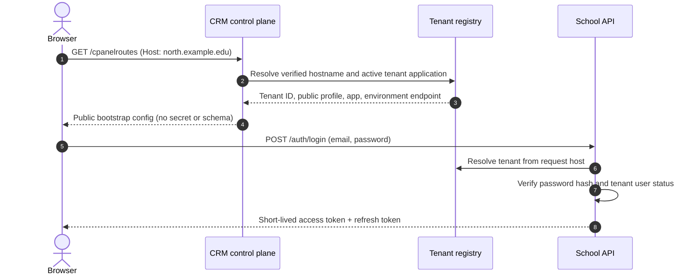
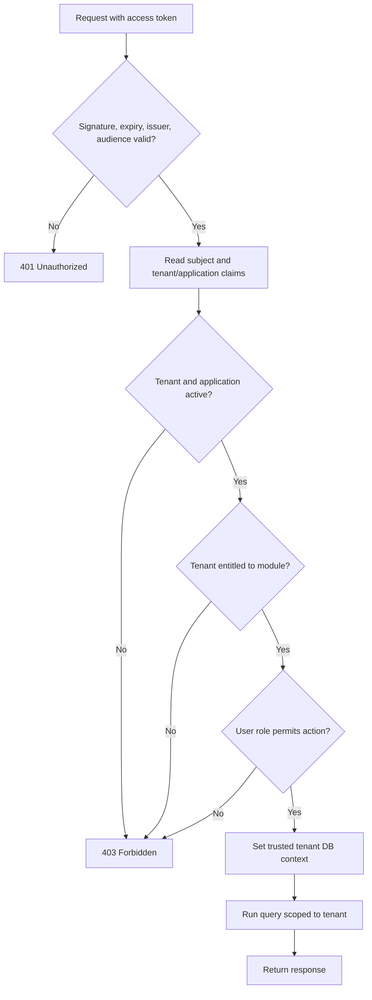
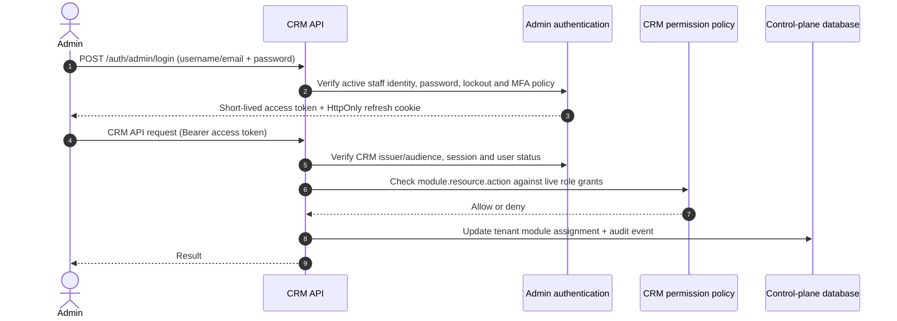

# Authentication and authorization flow

## 1. First load: resolve the tenant from the host

The client calls `GET /cpanelroutes` (the request host is used) or
`GET /cpanelroutes/:domain`. CRM looks up the normalized hostname in
`tenancy_tenant_domain`, then follows the tenant application, tenant,
application, and environment records. Only active tenant/application/environment
records are returned. Custom domains must be verified and have issued TLS.

The response includes public bootstrap data: tenant ID/code and display name,
locale/timezone/currency, application code/name, the matched domain, and an
optional HTTPS API endpoint configured for that environment. It must not
include a tenant secret, schema name/slug, database locator, API client secret,
or password hash. A browser is an untrusted public client: a secret embedded in
its response can be copied and reused. The API endpoint is filtered to remove
credentials, query parameters, and fragments; internal database routing stays
server-side.

## 2. Tenant sign-in

The client submits credentials to the tenant login endpoint over HTTPS. The
server resolves the tenant application from the request host and the control
plane registry; it must not accept a caller-supplied schema name as authority.
It verifies the password hash, tenant/application status, and user status, then
issues a short-lived tenant access token and a separately protected refresh
token. The token identifies the subject, tenant, tenant application, and
application audience. It must not contain a schema/database locator or secret.

The CRM `AuthService` verifies password hashes and refresh resolves the tenant's
schema on the server; schema names are no longer included in the issued token.
Its tenant lookup still uses the legacy `public.tenants` table. The current
school tenant plugin also uses that legacy table and currently prioritizes
headers/host over signed token claims. Migrate both to the `tenancy_*` registry
and make signed claims authoritative before treating this as a complete
production flow.

## 3. Tenant API authorization

For each protected school API request:

1. Verify the token signature, issuer, expiry, token type, and school-service
   audience.
2. Resolve tenant/application from signed claims and confirm they remain active.
3. Check the user's role/permissions and the tenant's module entitlement for the
   requested operation. Deny by default.
4. Apply tenant isolation in the database. Derive schema/connection routing from
   trusted server-side registry data, or use row-level security with a
   transaction-local tenant context. Never interpolate a schema from a request
   header or body.

Tenant IDs from headers may be used only as a consistency check against the
authenticated token. They must not override its tenant. Object queries must
also be scoped to the authenticated tenant.

## 4. CRM and cPanel authorization

CRM users authenticate as active `staff` records in `iam_app_user`, with a
distinct CRM audience from tenant users. Every protected CRM request requires
an active database session and a live `iam_fn_user_has_permission` grant.
Permission codes follow the schema's `module.resource.action` format, for
example `tenancy.tenant.read` or `iam.app_user.update`. Do not authorize from a
role name or a permission list copied into a long-lived token.

Tenant onboarding, domain changes, module assignments, and lifecycle changes
should be audited with actor, target, action, and timestamp. The CRM schema
already has session audit triggers and append-only `iam_login_attempt` records.
Privileged and MFA-enrolled accounts must not receive a session without MFA.

Tenant module availability is separate from user authorization: the tenant
must be entitled to the module, and the signed-in user must have permission to
perform the requested action in that module.

## Flow diagrams

### Tenant application startup and sign-in



### Tenant request authorization



Both checks in the middle are required: an entitled tenant does not grant every
user access to the module, and a user's role cannot grant a module the tenant
has not purchased or enabled.

### CRM administrator request



## Example: school tenant

Assume the browser loads `https://north.example.edu`, which is registered to
tenant `north-academy` for the `school` application.

```http
GET /cpanelroutes HTTP/1.1
Host: north.example.edu
```

Example response (public fields only):

```json
{
  "tenant_id": "8d77f046-c184-47af-a740-b80584420dfb",
  "tenant_code": "north-academy",
  "display_name": "North Academy",
  "timezone": "Asia/Kolkata",
  "default_locale": "en-IN",
  "default_currency_code": "INR",
  "application": { "code": "school", "name": "School Management" },
  "domain": "north.example.edu",
  "domain_type": "custom",
  "domain_shortcode": "north-academy",
  "api_endpoint": "https://school-api.example.com"
}
```

The user then signs in on that tenant host. Under the target token contract, the
verified claims identify `sub` as the user, `tenantId` as
`8d77f046-c184-47af-a740-b80584420dfb`, and `aud` as the school API.
When that user requests `GET /students`, the API checks both the tenant's
`students` module entitlement and the user's `student:read` permission before
querying tenant-scoped data. Neither `tenant_schema_name` nor
`tenant_secret_key` is sent to the browser.

## Current implementation

- `GET /cpanelroutes/:domain?` is public and resolves a domain against the
  `tenancy_*` control-plane tables. It returns public bootstrap metadata only.
- Tenant secrets and schema/database locators are intentionally not returned.
- CRM admin authentication uses `iam_app_user`, `iam_login_attempt`, and
  `iam_user_session`. Refresh credentials are random opaque values stored only
  as SHA-256 hashes in PostgreSQL and rotated on use. The access token is a
  short-lived JWT; the refresh cookie is HttpOnly and SameSite=Strict.
- Browser deployments must set `CORS_ORIGIN` to the exact CRM UI origin so
  credentialed refresh requests can send the cookie; wildcard CORS disables
  credential support. The refresh/logout endpoints also require that `Origin`.
- CRM protected routes accept administrator tokens only, check the backing
  session on each request, and call `iam_fn_user_has_permission` using a
  `module.resource.action` permission. Route config can set an exact
  `adminPermission`; otherwise the permission is inferred from the route path
  and HTTP verb. Add explicit metadata for special actions and verify the
  matching permission codes and role grants are provisioned in `iam_permission`
  and `iam_role_permission`.
- Public admin self-registration was removed. Provision the first staff
  identity and its least-privilege role through a trusted deployment process.
- MFA is fail-closed for users with MFA enabled or a privileged/MFA-required
  role. The SQL schema stores `secret_ref` as a KMS/vault reference, so CRM
  needs a secret-store-backed MFA verifier before those accounts can sign in.
  Admin sign-in is throttled at 30 failed attempts per IP in 15 minutes;
  deployments should also apply gateway rate limiting for distributed attacks.
- Tenant login still uses the legacy `public.tenants` lookup. Migrate it to the
  `tenancy_*` registry before treating tenant authentication as complete.

Admin API example:

```http
POST /auth/admin/login
Content-Type: application/json

{"email":"operator@example.com","password":"<password>"}
```

The response contains `accessToken`, `expiresIn`, and the public user profile;
the refresh token is set in the `SESSION_COOKIE_NAME` cookie. Send the access
token as `Authorization: Bearer <accessToken>`. Call
`POST /auth/admin/refresh` with browser credentials to rotate the cookie and
receive a new access token, and `POST /auth/admin/logout` to revoke the session.
