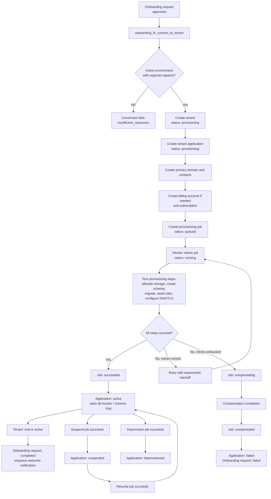

# Tenant application lifecycle

The database guards application creation against environment-region mismatches and inactive environments. It records each status transition in `tenancy_lifecycle_event`; provisioning job outcomes are applied by `trg_job_outcome`.
